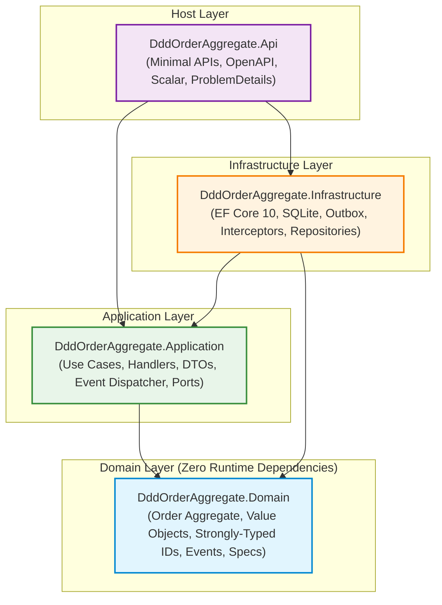

# Tactical Domain-Driven Design Reference Implementation in .NET 10 & C# 14

[](https://github.com/behnamnouri/DddOrderAggregate/actions/workflows/ci.yml)
[](LICENSE)
[](global.json)
[](Directory.Build.props)

A reference implementation demonstrating **tactical Domain-Driven Design (DDD)** on **.NET 10** (`net10.0`, LTS) and **C# 14**, structured around Clean Architecture. I built this repository to showcase production-grade aggregate design, encapsulation, transactional boundaries, optimistic concurrency, and persistence mapping using a deliberately focused, realistic domain: an **Order** aggregate managing its **OrderLine** children.

Every tactical DDD pattern appears exactly once, fully tested, documented with Architecture Decision Records (ADRs), and backed by an automated test suite verifying invariants, concurrency, and architecture rules.

---

## Architecture & Dependency Flow

The solution follows strict Clean Architecture dependency rules. The **Domain** layer stands at the core of the onion and has **zero** dependencies on external libraries or outer layers.



### Why Domain Has Zero Outbound Arrows
- The Domain model embodies the ubiquitous language and business rules of the ordering bounded context. It must remain pure, isolated from frameworks, databases, network concerns, and external serialization quirks.
- Domain rules can be tested in sub-millisecond unit tests without mocking frameworks, database engines, or container setups.
- Non-deterministic APIs (`DateTime.UtcNow`, `Guid.NewGuid()`) are strictly banned from Domain code via Roslyn analyzers (`BannedSymbols.txt`). Time is always passed explicitly as a parameter; IDs are generated via strongly-typed ID factories (`OrderId.New()`).

---

## Tactical DDD Concept Map

| Tactical Concept | Implementation File | Architectural Role |
| :--- | :--- | :--- |
| **Aggregate Root** | [`Order.cs`](file:///d:/Projects/Code/ant/DddOrderAggregate/src/DddOrderAggregate.Domain/Orders/Order.cs) | Enforces invariants, owns child lines, controls mutations, manages versioning. |
| **Internal Entity** | [`OrderLine.cs`](file:///d:/Projects/Code/ant/DddOrderAggregate/src/DddOrderAggregate.Domain/Orders/OrderLine.cs) | Child entity within aggregate boundary; internal mutators callable only by the root. |
| **Value Object** | [`Money.cs`](file:///d:/Projects/Code/ant/DddOrderAggregate/src/DddOrderAggregate.Domain/ValueObjects/Money.cs), [`Quantity.cs`](file:///d:/Projects/Code/ant/DddOrderAggregate/src/DddOrderAggregate.Domain/ValueObjects/Quantity.cs), [`Currency.cs`](file:///d:/Projects/Code/ant/DddOrderAggregate/src/DddOrderAggregate.Domain/ValueObjects/Currency.cs), [`Address.cs`](file:///d:/Projects/Code/ant/DddOrderAggregate/src/DddOrderAggregate.Domain/ValueObjects/Address.cs) | Immutable concept with value equality, self-validation, and private copy constructors. |
| **Strongly-Typed ID** | [`OrderId.cs`](file:///d:/Projects/Code/ant/DddOrderAggregate/src/DddOrderAggregate.Domain/Identifiers/OrderId.cs), [`OrderLineId.cs`](file:///d:/Projects/Code/ant/DddOrderAggregate/src/DddOrderAggregate.Domain/Identifiers/OrderLineId.cs), [`CustomerId.cs`](file:///d:/Projects/Code/ant/DddOrderAggregate/src/DddOrderAggregate.Domain/Identifiers/CustomerId.cs), [`ProductId.cs`](file:///d:/Projects/Code/ant/DddOrderAggregate/src/DddOrderAggregate.Domain/Identifiers/ProductId.cs) | Readonly record struct wrapping UUIDv7; prevents accidental parameter swapping. |
| **Domain Event** | [`OrderEvents.cs`](file:///d:/Projects/Code/ant/DddOrderAggregate/src/DddOrderAggregate.Domain/Orders/OrderEvents.cs) | Immutable record representing a state change that already happened within the aggregate. |
| **Integration Event** | [`OrderIntegrationEvents.cs`](file:///d:/Projects/Code/ant/DddOrderAggregate/src/DddOrderAggregate.Application/Orders/Events/OrderIntegrationEvents.cs) | Boundary event published to the Transactional Outbox for consumption by other contexts. |
| **Specification** | [`OrderSpecifications.cs`](file:///d:/Projects/Code/ant/DddOrderAggregate/src/DddOrderAggregate.Domain/Orders/Specifications/OrderSpecifications.cs) | Encapsulated domain predicate reusable across in-memory evaluation and EF Core LINQ queries. |
| **Repository** | [`IOrderRepository.cs`](file:///d:/Projects/Code/ant/DddOrderAggregate/src/DddOrderAggregate.Domain/Orders/IOrderRepository.cs), [`OrderRepository.cs`](file:///d:/Projects/Code/ant/DddOrderAggregate/src/DddOrderAggregate.Infrastructure/Persistence/Repositories/OrderRepository.cs) | Persistence abstraction exclusively for the Aggregate Root. No `IOrderLineRepository` exists. |
| **Read Repository** | [`IOrderReadRepository.cs`](file:///d:/Projects/Code/ant/DddOrderAggregate/src/DddOrderAggregate.Application/Common/Persistence/IOrderReadRepository.cs), [`OrderReadRepository.cs`](file:///d:/Projects/Code/ant/DddOrderAggregate/src/DddOrderAggregate.Infrastructure/Persistence/Repositories/OrderReadRepository.cs) | Non-tracking projection queries for read models, completely decoupled from aggregate state tracking. |
| **Factory Method** | [`Order.Create(...)`](file:///d:/Projects/Code/ant/DddOrderAggregate/src/DddOrderAggregate.Domain/Orders/Order.cs#L35) | Private constructor and public static factory method to guarantee that an aggregate is always valid upon instantiation. |
| **Anti-Corruption Layer** | [`IProductCatalog.cs`](file:///d:/Projects/Code/ant/DddOrderAggregate/src/DddOrderAggregate.Application/Common/Ports/IProductCatalog.cs), [`InMemoryProductCatalog.cs`](file:///d:/Projects/Code/ant/DddOrderAggregate/src/DddOrderAggregate.Infrastructure/Catalog/InMemoryProductCatalog.cs) | Isolates Ordering domain from the upstream Catalog context; stores snapshots of Product Name and Unit Price. |
| **Transactional Outbox** | [`OutboxMessage.cs`](file:///d:/Projects/Code/ant/DddOrderAggregate/src/DddOrderAggregate.Infrastructure/Outbox/OutboxMessage.cs), [`OutboxProcessor.cs`](file:///d:/Projects/Code/ant/DddOrderAggregate/src/DddOrderAggregate.Infrastructure/Outbox/OutboxProcessor.cs) | Guarantees atomic state persistence and outbox publication in a single database transaction. |
| **Optimistic Concurrency** | [`Order.cs`](file:///d:/Projects/Code/ant/DddOrderAggregate/src/DddOrderAggregate.Domain/Orders/Order.cs#L22), [`OrderEndpoints.cs`](file:///d:/Projects/Code/ant/DddOrderAggregate/src/DddOrderAggregate.Api/Endpoints/OrderEndpoints.cs) | Aggregate `Version` property mapped as EF concurrency token; exposed via HTTP `ETag` and enforced via `If-Match`. |
| **Ubiquitous Language** | [`ubiquitous-language.md`](file:///d:/Projects/Code/ant/DddOrderAggregate/docs/domain/ubiquitous-language.md) | Shared glossary bridging business domain concepts directly to code constructs and methods. |

---

## Aggregate Boundary Rationale

### 1. Why `OrderLine` Has No Repository
An aggregate represents a consistency boundary. In DDD, external callers must never mutate internal child entities directly. 
- If an `IOrderLineRepository` existed, an endpoint or service could query an `OrderLine` directly, update its quantity or delete it, and bypass the `Order` aggregate root entirely.
- Bypassing the aggregate root breaks invariants: the order total would not recalculate, max line limits (INV-04) would not be enforced, modifications to submitted orders (INV-02) would not be blocked, and domain events would not fire.
- Therefore, `Order` is the **only** entry point. EF Core's navigation mapping loads child lines as part of the aggregate, and child entity mutators are marked `internal`.

### 2. Why Other Aggregates Are Referenced by ID Only
- In this bounded context, `CustomerId` and `ProductId` are strongly-typed identifier value objects, not object references or navigation properties.
- Customers and Products belong to independent bounded contexts with their own lifecycles, consistency boundaries, and persistence models. Holding a reference to a `Customer` or `Product` entity inside the `Order` aggregate would create cross-aggregate tight coupling, bloat transaction boundaries, and lead to massive object graphs being loaded on every order fetch.

### 3. Why Product Name and Unit Price Are Stored as a Snapshot
- When an order line is created, the system captures the product's name and price at that exact instant (`ProductSnapshot`).
- Catalog prices and titles change constantly over time. An order placed today for \$10 must remain \$10 when viewed five years later, regardless of whether the product was subsequently repriced, rebranded, or retired.

---

## Rich Domain Model vs. Anemic Domain Model

### The Anemic Anti-Pattern (What We Avoid)
```csharp
// ❌ ANEMIC DOMAIN MODEL: Data bag with public getters and setters
public class AnemicOrder
{
    public Guid Id { get; set; }
    public string Status { get; set; }
    public decimal TotalAmount { get; set; }
    public List<AnemicOrderLine> Lines { get; set; } = new();
}

// Logic leaked into a "Service" class; invariants are scattered and unenforceable
public class OrderService
{
    public void AddLine(AnemicOrder order, Guid productId, int quantity, decimal price)
    {
        // Easy to forget checks, bypass validation, or fail to update TotalAmount
        order.Lines.Add(new AnemicOrderLine { ProductId = productId, Quantity = quantity, Price = price });
        order.TotalAmount += quantity * price; 
    }
}
```

### The Rich Domain Model (This Repository)
```csharp
// ✅ RICH DOMAIN MODEL: Fully encapsulated aggregate root protecting invariants
public sealed class Order : AggregateRoot<OrderId>
{
    private readonly List<OrderLine> _lines = [];
    public IReadOnlyCollection<OrderLine> Lines => _lines.AsReadOnly();

    public Result AddLine(ProductId productId, string productName, Money unitPrice, Quantity quantity, DateTimeOffset now)
    {
        if (Status != OrderStatus.Draft)
            return Result.Failure(OrderErrors.CannotModifyNonDraft(Status));

        var existing = _lines.Find(l => l.ProductId == productId);
        if (existing is not null)
        {
            var mergedQuantity = existing.Quantity.Value + quantity.Value;
            var newQuantity = Quantity.Create(mergedQuantity);
            if (newQuantity.IsFailure)
                return Result.Failure(newQuantity.Error);

            existing.UpdateQuantity(newQuantity.Value);
        }
        else
        {
            if (_lines.Count >= MaxLines)
                return Result.Failure(OrderErrors.MaxLinesExceeded(MaxLines));

            _lines.Add(OrderLine.Create(OrderId, productId, productName, unitPrice, quantity));
        }

        RecalculateTotal();
        Touch(now);
        RaiseDomainEvent(new OrderLineAddedDomainEvent(Id, productId, quantity.Value));
        return Result.Success();
    }
}
```

---

## DDD Mistakes This Repository Avoids

1. **Anemic Domain Models**: Domain classes are never mere DTOs with `{ get; set; }`. Every state transition is executed through an intention-revealing method that validates business rules.
2. **Leaking Internal Entities**: `Order.Lines` is exposed as an immutable `IReadOnlyCollection<OrderLine>`. Child entity mutators (`UpdateQuantity`) are `internal`, ensuring only the `Order` aggregate root can alter child state.
3. **One Repository Per Database Table**: Repositories exist **only** for aggregate roots (`IOrderRepository`). There is no repository for `OrderLine` or `Address`.
4. **Oversized Aggregates**: The aggregate contains only the data strictly required to protect transactional invariants. Large text payloads, binary blobs, and neighboring entity trees are excluded.
5. **Infrastructure Bleeding into Domain**: Zero EF Core annotations, JSON serialization attributes, or database-specific types appear in the Domain project.
6. **Domain Events as Remote RPCs**: Domain events represent in-process notifications dispatched within the local transaction boundary. Cross-boundary messaging uses Integration Events dispatched asynchronously via the Transactional Outbox.
7. **Primitive Obsession**: Raw `Guid`, `decimal`, and `int` primitives are replaced by strongly-typed value objects (`OrderId`, `Money`, `Quantity`, `Currency`) that guarantee validity upon construction.

---

## When DDD is Overkill

Domain-Driven Design introduces conceptual layers, abstraction boundaries, and boilerplate mapping. It is **not** appropriate for every system:
- **Simple CRUD Applications**: If the business requirements are merely creating, reading, updating, and deleting rows with minimal cross-field rules, a standard CRUD API with EF Core or Dapper is simpler, faster to deliver, and easier to maintain.
- **Reporting & Data Warehousing Systems**: Systems dominated by read-heavy projections, analytics, and ETL pipelines should favor direct SQL, views, or document storage over domain aggregates.
- **Prototypes & Throwaway MVPs**: When the problem domain is ill-defined and requirements shift daily, investing in deep aggregate modeling and value objects can create friction without delivering immediate value.

DDD shines when **business logic is intricate, invariants span multiple interrelated concepts, and the cost of inconsistent or corrupt state is high**.

---

## Intentional Design Trade-offs

| Decision | Trade-off Made | Rationale |
| :--- | :--- | :--- |
| **No Authentication / Authorization** | Omitted JWT / OAuth middleware. | Keeps the repository focused strictly on tactical DDD and clean aggregate boundaries without configuration noise. |
| **State-Based vs. Event-Sourced** | Used relational state mapping instead of an event store. | Simpler persistence model for majority enterprise use cases; outbox still provides event-driven integration capabilities. |
| **Single-Instance Outbox Processor** | In-memory timer polling SQLite outbox table. | Eliminates external queue dependencies (RabbitMQ, Azure Service Bus) while demonstrating the exact transactional outbox pattern. In production, this can be swapped with a distributed worker. |
| **In-Memory Catalog Stub** | Hardcoded catalog service with seeded data. | Eliminates the need to run an upstream Catalog service while proving the Anti-Corruption Layer (ACL) pattern. |

---

## Getting Started

### Prerequisites
- [.NET 10 SDK](https://dotnet.microsoft.com/download/dotnet/10.0) (`10.0.403` or later)
- Git

### Running the API
```powershell
# Restore dependencies and build the solution
dotnet build

# Run the API project
dotnet run --project src/DddOrderAggregate.Api
```

The API starts on:
- HTTP: `http://localhost:5000`
- HTTPS: `https://localhost:5001`
- **Scalar Interactive Documentation**: `http://localhost:5000/scalar` (or `https://localhost:5001/scalar`)
- **Health Checks**: `http://localhost:5000/health` and `/health/ready`

### Running the Tests
The test suite consists of 87 automated tests executed via **Microsoft.Testing.Platform** and **xUnit v3**:

```powershell
# Run the entire test suite across Unit, Integration, and Architecture test projects
dotnet test
```

### Executing HTTP Requests
An interactive HTTP file containing 20 requests covering the entire lifecycle (Draft $\to$ Submitted $\to$ Paid $\to$ Shipped / Cancelled, plus concurrency and validation failure paths) is located at:
- [`requests/orders.http`](file:///d:/Projects/Code/ant/DddOrderAggregate/requests/orders.http)

Compatible with the Visual Studio REST Client, JetBrains Rider HTTP Client, or the VS Code REST Client extension.

---

## Architecture Decision Records (ADRs)

Key architectural decisions are recorded in `docs/adr/`:
- [ADR 0001: Tactical DDD Scope and Single Bounded Context](file:///d:/Projects/Code/ant/DddOrderAggregate/docs/adr/0001-tactical-ddd-scope-and-single-bounded-context.md)
- [ADR 0002: Aggregate Boundary and Internal Entities](file:///d:/Projects/Code/ant/DddOrderAggregate/docs/adr/0002-aggregate-boundary.md)
- [ADR 0003: Hand-Written Strongly-Typed IDs](file:///d:/Projects/Code/ant/DddOrderAggregate/docs/adr/0003-hand-written-strongly-typed-ids.md)
- [ADR 0004: Value Objects and EF Core 10 Mapping](file:///d:/Projects/Code/ant/DddOrderAggregate/docs/adr/0004-value-objects-and-ef-core-mapping.md)
- [ADR 0005: Money as Minor Units](file:///d:/Projects/Code/ant/DddOrderAggregate/docs/adr/0005-money-as-minor-units.md)
- [ADR 0006: Result Pattern for Business Errors](file:///d:/Projects/Code/ant/DddOrderAggregate/docs/adr/0006-result-pattern-for-business-errors.md)
- [ADR 0007: Domain Events and Transactional Outbox](file:///d:/Projects/Code/ant/DddOrderAggregate/docs/adr/0007-domain-events-and-transactional-outbox.md)
- [ADR 0008: Hand-Written Specification Pattern](file:///d:/Projects/Code/ant/DddOrderAggregate/docs/adr/0008-hand-written-specification-pattern.md)
- [ADR 0009: No Mediator Library - Direct Handler Injection](file:///d:/Projects/Code/ant/DddOrderAggregate/docs/adr/0009-no-mediator-library-direct-handler-injection.md)
- [ADR 0010: Optimistic Concurrency with ETag and If-Match](file:///d:/Projects/Code/ant/DddOrderAggregate/docs/adr/0010-optimistic-concurrency-with-etag-and-if-match.md)
- [ADR 0011: SQLite Default with Committed Migrations](file:///d:/Projects/Code/ant/DddOrderAggregate/docs/adr/0011-sqlite-default-with-committed-migrations.md)
- [ADR 0012: Banned API Analyzer for Domain Determinism](file:///d:/Projects/Code/ant/DddOrderAggregate/docs/adr/0012-banned-api-analyzer-for-domain-determinism.md)

---

## Technical Interview Guide

For a curated collection of 15 in-depth interview questions and answers mapping directly to this codebase, see:
- [Technical Interview Notes](file:///d:/Projects/Code/ant/DddOrderAggregate/docs/INTERVIEW-NOTES.md)

---

## License

This project is licensed under the [MIT License](LICENSE).
