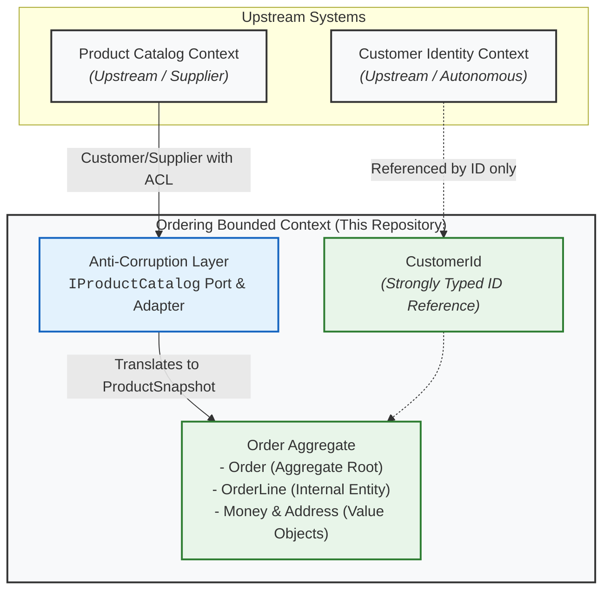

# Context Map: Ordering Bounded Context

I designed the Ordering bounded context as a self-contained domain model focused strictly on order authoring, validation, pricing immutability, and state progression. In enterprise architectures, order management rarely lives in isolation, so this document clarifies how Ordering integrates with upstream and external contexts without compromising its domain invariants.

## Context Map Diagram

## Strategic Relationships & Boundaries

### 1. Product Catalog Context &rarr; Ordering Context: Customer/Supplier with Anti-Corruption Layer (ACL)
- **Relationship Type**: Customer/Supplier (`U/D`, Catalog is Upstream, Ordering is Downstream) mediated by an **Anti-Corruption Layer (ACL)**.
- **Rationale**: The Product Catalog context has its own release cycle, rich category taxonomy, supplier metadata, inventory tracking, and search indexing. If Ordering bound directly to Catalog entities or domain models, changes to Catalog schemas would bleed directly into the core Order aggregate (a Conformist relationship).
- **Implementation**:
  - Ordering defines an inbound port (`IProductCatalog`) in the Application layer.
  - The Infrastructure adapter queries the catalog system and maps external models into a pure domain-friendly `ProductSnapshot` value (ProductId, product name, and current unit price as `Money`).
  - The Order aggregate captures an immutable snapshot of `ProductName` and `UnitPrice` upon line addition. If the product price changes in the catalog tomorrow, historical and pending orders preserve their agreed contract price.

### 2. Customer Identity Context &rarr; Ordering Context: Reference by Identity Only
- **Relationship Type**: Autonomous reference without domain sharing.
- **Rationale**: Ordering does not manage user credentials, payment profiles, customer tiers, or contact details. Modeling Customer as an aggregate inside Ordering would violate single responsibility and create bloated aggregate boundaries.
- **Implementation**:
  - Ordering references customers purely by identity: `CustomerId` (a strongly-typed GUID value object).
  - Ordering makes no assumptions about customer fields and requires no runtime queries back to Customer services to create an order. The customer ID acts as a foreign correlation key.
