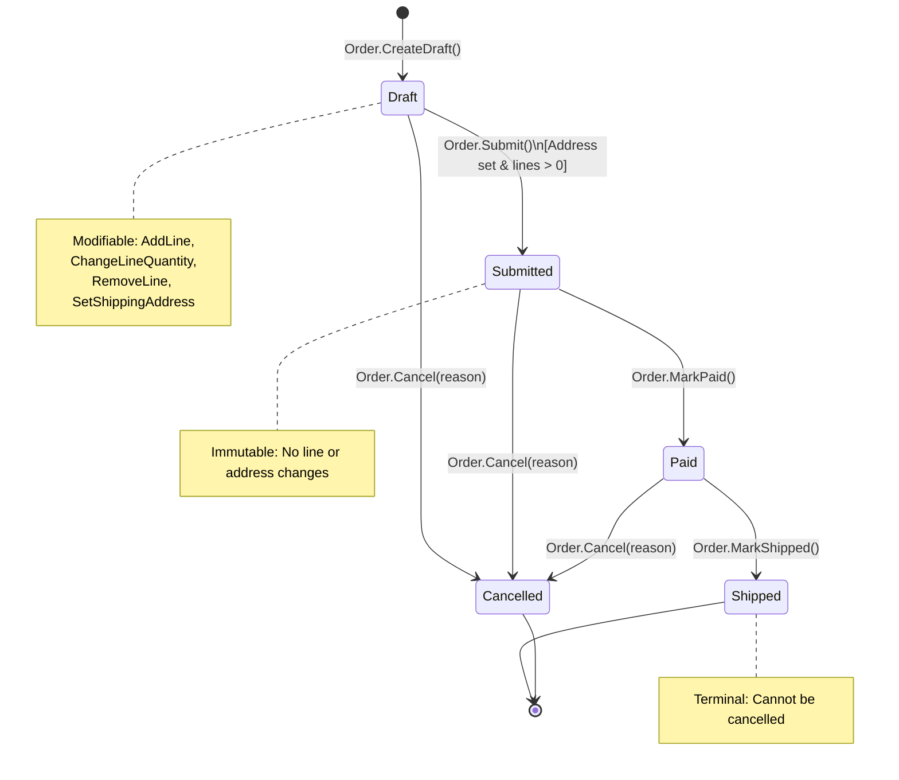

# Order Lifecycle & Aggregate Invariants

This document specifies the complete finite state machine for the Order aggregate and the exact invariant catalogue (INV-01 through INV-12) enforced by the aggregate boundary.

## State Machine Diagram

## Aggregate Invariants Specification Table

| Invariant ID | Rule Description | Enforcing Domain Method | Verification Test(s) |
| :--- | :--- | :--- | :--- |
| **INV-01** | An order belongs to one customer and has one currency, both fixed at creation. | `Order.CreateDraft(customerId, currency, now)` | `OrderTests.Invariant_INV01_CustomerAndCurrencyFixedAtCreation` |
| **INV-02** | Lines can be added, changed or removed, and the shipping address can be set, only while the order is Draft. | `Order.AddLine`, `Order.ChangeLineQuantity`, `Order.RemoveLine`, `Order.SetShippingAddress` | `OrderTests.Invariant_INV02_ModificationsAllowedOnlyInDraft` |
| **INV-03** | A product appears at most once per order; adding it again merges the quantity into the existing line and keeps the original unit price snapshot. | `Order.AddLine` | `OrderTests.Invariant_INV03_ProductAddedAgainMergesQuantityAndKeepsOriginalPrice` |
| **INV-04** | Quantity per line is 1..100; at most 20 lines per order. | `Quantity.Create`, `Order.AddLine` | `OrderTests.Invariant_INV04_QuantityBetween1And100_AndAtMost20Lines` |
| **INV-05** | A line's unit price is positive and in the order's currency. | `Order.AddLine`, `Money.Create` | `OrderTests.Invariant_INV05_UnitPriceMustBePositiveAndMatchOrderCurrency` |
| **INV-06** | The order total always equals the sum of its line totals (the aggregate recalculates it after every line change). | `Order.AddLine`, `Order.ChangeLineQuantity`, `Order.RemoveLine`, `Order.RecalculateTotal` | `OrderTests.Invariant_INV06_OrderTotalAlwaysEqualsSumOfLineTotals` |
| **INV-07** | A shipping address is required before submit. | `Order.Submit` | `OrderTests.Invariant_INV07_ShippingAddressRequiredBeforeSubmit` |
| **INV-08** | An empty order cannot be submitted; submit is allowed only from Draft. | `Order.Submit` | `OrderTests.Invariant_INV08_EmptyOrderCannotBeSubmitted` |
| **INV-09** | Allowed transitions only: Draft to Submitted to Paid to Shipped; Cancelled is allowed from Draft, Submitted or Paid, never from Shipped or Cancelled. | `Order.CanTransitionTo`, `Order.Submit`, `Order.MarkPaid`, `Order.MarkShipped`, `Order.Cancel` | `OrderTests.Invariant_INV09_AllowedAndDisallowedStateTransitions` |
| **INV-10** | Cancelling requires a reason of 1..200 characters. | `Order.Cancel` | `OrderTests.Invariant_INV10_CancelRequiresReasonOf1To200Characters` |
| **INV-11** | Aggregate state can be changed only through the root's methods (lines are exposed read-only; line mutators are internal). | `Order.Lines` (`IReadOnlyList<OrderLine>`), `OrderLine` internal mutators | `OrderTests.Invariant_INV11_AggregateStateEncapsulatedAndLinesReadOnly` |
| **INV-12** | A domain event is raised only when a state change succeeds; failed operations raise nothing and change nothing. | `AggregateRoot.RaiseDomainEvent`, all `Order` mutation methods | `OrderTests.Invariant_INV12_DomainEventsRaisedOnlyOnSuccessfulStateChange` |
